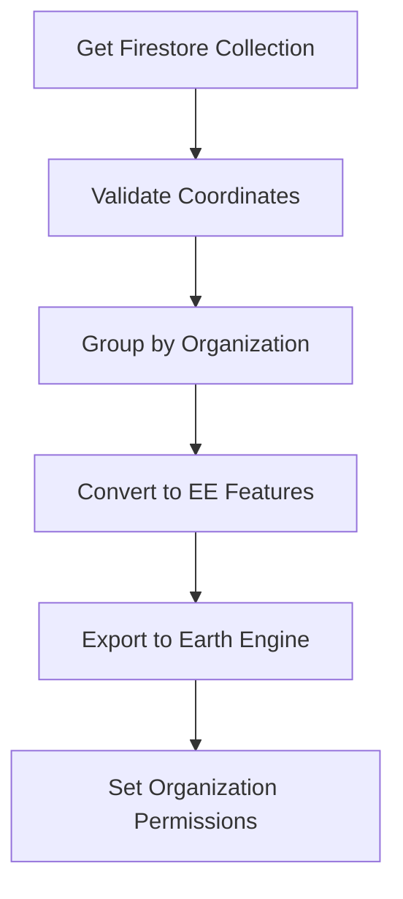
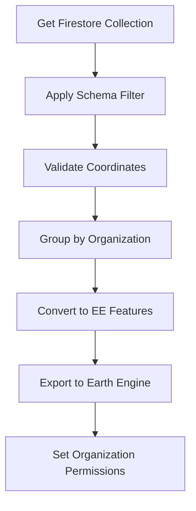

# Firestore Earth Engine ETL

Sistema ETL (Extract, Transform, Load) que sincroniza dados entre Google Cloud Firestore e Google Earth Engine para análise geoespacial de amostras do TimberID.

## Visão Geral

Esta Cloud Function HTTP implementa um pipeline de dados que extrai amostras armazenadas no Firestore, as transforma em Features geoespaciais e as carrega no Google Earth Engine organizadas por organização, permitindo análises geoespaciais avançadas e compartilhamento controlado de dados.

## Arquitetura

```
Firestore Collections → Data Validation → Earth Engine Features → Organizational Assets
     ↓                        ↓                    ↓                      ↓
trusted_samples         Coordinate Check      ee.Feature Points    {org}/trusted_samples
untrusted_samples       Schema Validation     Timestamp Added      {org}/untrusted_samples
```

## Funcionalidades Principais

### 1. Extração de Dados (Extract)

**Coleções Processadas:**

- `trusted_samples`: Amostras verificadas e confiáveis
- `untrusted_samples`: Amostras em processo de validação

**Campos Extraídos:**

**Trusted Samples:**

```python
trusted_schema = [
    "lat", "lon", "points", "created_on", "org_name"
]
```

**Untrusted Samples:**

```python
untrusted_schema = [
    "lat", "lon", "carbon", "nitrogen", "oxygen",
    "validity", "validity_details", "created_on",
    "date_of_harvest", "org_name"
]
```

### 2. Transformação de Dados (Transform)

**Validação de Coordenadas:**

- Verificação de presença de campos `lat` e `lon`
- Conversão para float com tratamento de erro
- Skip automático de documentos com coordenadas inválidas

**Processamento Organizacional:**

- Agrupamento por `org_name` (organizações)
- Fallback para `'no-org'` quando organização não especificada
- Normalização de nomes para lowercase

**Conversão para Earth Engine:**

```python
# Criação de Feature geoespacial
feature = ee.Feature(
    ee.Geometry.Point(lon, lat),  # Geometria de ponto
    properties_dict               # Propriedades da amostra
)
feature.set('system:time_start', created_on)  # Timestamp para análise temporal
```

**Tratamento de Datas:**

- Conversão de strings para `ee.Date`
- Fallback para data atual em caso de formato inválido
- Timestamp para análises temporais no Earth Engine

### 3. Carregamento no Earth Engine (Load)

**Estrutura de Assets:**

```
projects/{GCP_PROJECT_ID}/assets/ee_org/
├── {org_name_1}/
│   ├── trusted_samples
│   └── untrusted_samples
├── {org_name_2}/
│   ├── trusted_samples
│   └── untrusted_samples
└── no-org/
    ├── trusted_samples
    └── untrusted_samples
```

**Processo de Upload:**

1. **Verificação de Assets**: Lista assets existentes na pasta organizacional
2. **Limpeza**: Remove assets antigos com mesmo nome
3. **Export**: Cria task de export para Earth Engine
4. **Monitoramento**: Polling até conclusão do task
5. **Permissões**: Configura ACL para acesso organizacional

**Controle de Acesso:**

```python
# Permissões por organização
org_email = f"{org_name}@timberid.org"
# Para ambiente de teste
if GCP_PROJECT_ID == 'river-sky-386919':
    org_email = f"{org_name}-test@timberid.org"

acl = {"writers": [f"group:{org_email}"]}
ee.data.setAssetAcl(AssetId, acl)
```

## Configuração

### Variáveis de Ambiente

```bash
# Projeto GCP para Earth Engine
GCP_PROJECT_ID=your-project-id

# Path base para assets organizacionais
ORG_EE_PATH=projects/{GCP_PROJECT_ID}/assets/ee_org
```

### Dependências

```python
# Core Cloud Functions
functions-framework==3.3.0
google-events==0.4.0
cloudevents==1.9.0

# Google Cloud Services
google-cloud-firestore
firebase-admin
google-api-core

# Earth Engine
earthengine-api==0.1.358

# Data Processing
numpy
scipy
protobuf==4.22.1
```

## Estrutura de Dados

### Trusted Samples

```json
{
  "lat": -13.0845,
  "lon": -53.3795,
  "org_name": "organization-name",
  "created_on": "2023-09-08",
  "points": [
    {
      "d18O_cel": 23.5,
      "d15N_wood": 2.1,
      "d13C_wood": -25.4,
      "code": "sample_001",
      "date_of_harvest": "2023-07-15"
    }
  ]
}
```

### Untrusted Samples

```json
{
  "lat": -13.0845,
  "lon": -53.3795,
  "org_name": "organization-name",
  "created_on": "2023-09-08",
  "carbon": [-25.4, -25.7, -25.1],
  "nitrogen": [2.1, 2.3, 2.0],
  "oxygen": [23.5, 24.1, 23.8],
  "validity": "invalid",
  "validity_details": {
    "p_value_oxygen": 0.001,
    "p_value_carbon": 0.0003,
    "reference_mean": 25.2
  },
  "date_of_harvest": "2023-07-15"
}
```

## Uso

### Execução Manual

```bash
# Trigger via HTTP request
curl -X POST https://your-region-your-project.cloudfunctions.net/etl
```

### Execução Programática

```python
import requests

# Chamar função ETL
response = requests.post(
    'https://your-region-your-project.cloudfunctions.net/etl'
)
print(response.text)  # "done"
```

### Integração com Scheduler

```yaml
# Cloud Scheduler job
name: firestore-ee-etl-daily
schedule: "0 2 * * *" # Diário às 2h
target:
  httpTarget:
    uri: https://your-region-your-project.cloudfunctions.net/etl
    httpMethod: POST
```

## Fluxo de Processamento Detalhado

### 1. Inicialização

```python
# Autenticação Earth Engine
credentials, project_id = google.auth.default()
ee.Initialize(credentials)

# Cliente Firestore
client = firestore.client()
```

### 2. Processamento de Trusted Samples



### 3. Processamento de Untrusted Samples



## Funções Auxiliares

### get_asset_list()

Recupera recursivamente lista de assets em pasta do Earth Engine.

```python
def get_asset_list(parent_name):
    # Lista assets recursivamente
    # Retorna lista de IDs de assets
    # Trata erros de acesso/permissão
```

### transform_snapshot_to_featuresCollection_trusted()

Converte trusted samples para Features do Earth Engine.

```python
def transform_snapshot_to_featuresCollection_trusted(collectionSnapshot):
    # Processa campo 'points' para múltiplas medições
    # Valida coordenadas e organização
    # Cria Features com geometria Point
    # Agrupa por org_name
```

### transform_snapshot_to_featuresCollection_untrusted()

Converte untrusted samples para Features do Earth Engine.

```python
def transform_snapshot_to_featuresCollection_untrusted(collectionSnapshot, schema):
    # Aplica schema específico para campos
    # Valida coordenadas e dados isotópicos
    # Cria Feature única por sample
    # Agrupa por org_name
```

### save_collection_to_ee()

Salva FeatureCollection no Earth Engine com permissões organizacionais.

```python
def save_collection_to_ee(collection, asset_name):
    # Remove assets antigos
    # Cria task de export
    # Monitora conclusão
    # Configura permissões ACL
```

## Monitoramento e Logs

### Logs de Execução

```python
# Coordenadas inválidas
print("skipping entry: " + str(doc.id) + " , invalid lat/lon")

# Formato de data inválido
print('date format is invalid')

# Asset não encontrado
print('can not retreive assets list of ' + parent_name)

# Status do task
print(task.status())
```

### Métricas Importantes

- **Documentos processados**: Total de samples válidas por coleção
- **Documentos ignorados**: Samples com coordenadas inválidas
- **Taxa de sucesso**: Percentual de uploads bem-sucedidos
- **Tempo de processamento**: Duração total do ETL
- **Organizações ativas**: Número de orgs com dados

## Tratamento de Erros

### Validação de Coordenadas

```python
try:
    lat = float(raw_value['lat'])
    lon = float(raw_value['lon'])
    is_lat_lon_valid = True
except Exception as e:
    print("lat lon can not be casted into float")
    # Skip documento
```

### Processamento de Datas

```python
try:
    created_on = ee.Date(raw_value["created_on"])
except Exception as e:
    print('date format is invalid')
    created_on = ee.Date(datetime.now())  # Fallback
```

### Assets do Earth Engine

```python
try:
    parent_asset = ee.data.getAsset(parent_name)
    # Processar assets
except Exception as e:
    print('can not retreive assets list of ' + parent_name)
    return "NaN"  # Indicador de erro
```

## Limitações e Considerações

### Earth Engine

- **Quotas de Export**: Limite de tasks simultâneos
- **Tamanho de FeatureCollection**: Máximo de features por collection
- **Rate Limiting**: Throttling de requests da API
- **Asset Naming**: Restrições de caracteres em nomes

### Firestore

- **Read Quotas**: Custo de leitura de coleções grandes
- **Document Size**: Limite de 1MB por documento
- **Concurrent Reads**: Limite de leituras simultâneas

### Performance

- **Processamento Síncrono**: Execução sequencial pode ser lenta
- **Memory Usage**: Collections grandes podem esgotar memória
- **Timeout**: Cloud Functions têm limite de tempo de execução

## Melhorias Futuras

### Otimizações Planejadas

- [ ] **Processamento Incremental**: ETL apenas de documentos modificados
- [ ] **Batching**: Processamento em lotes para better performance
- [ ] **Paralelização**: Tasks assíncronos para múltiplas organizações
- [ ] **Cache**: Cache de asset lists para reduzir API calls
- [ ] **Resumable Exports**: Retry automático para exports falhados

### Funcionalidades Novas

- [ ] **Versionamento**: Histórico de versions dos assets
- [ ] **Validação de Schema**: Validação mais rigorosa dos dados
- [ ] **Métricas Avançadas**: Dashboard de monitoramento
- [ ] **Alerts**: Notificações para failures ou anomalias
- [ ] **Data Quality**: Relatórios de qualidade dos dados

### Arquitetura

- [ ] **Event-Driven**: Trigger automático em mudanças do Firestore
- [ ] **Serverless Workflows**: Orquestração com Cloud Workflows
- [ ] **Multi-Region**: Deployment em múltiplas regiões
- [ ] **Backup Strategy**: Backup automático de assets críticos

## Troubleshooting

### Problemas Comuns

**1. Earth Engine Authentication Error**

```bash
# Verificar service account
gcloud auth list
# Verificar permissões EE
```

**2. Firestore Permission Denied**

```bash
# Verificar IAM roles
# Firestore User role necessário
```

**3. Asset Export Failed**

```python
# Verificar logs do task
print(task.status())
# Verificar quotas EE
```

**4. Invalid Coordinates**

```python
# Validar formato lat/lon
# Verificar range válido (-90,90) (-180,180)
```

### Debug Local

```python
# Testar localmente
export GOOGLE_APPLICATION_CREDENTIALS="path/to/service-account.json"
export GCP_PROJECT_ID="your-project-id"

# Executar função
functions-framework --target=etl --source=main.py
```

## Estrutura do Projeto

```
Firestore-Earth-Engine-ETL/
├── main.py              # Cloud Function principal
├── requirements.txt     # Dependências Python
└── README.md           # Documentação (este arquivo)
```

## Exemplo de Execução

### Input (Firestore)

```json
// trusted_samples/sample_001
{
  "lat": -13.0845,
  "lon": -53.3795,
  "org_name": "forest-research-org",
  "created_on": "2023-09-08",
  "points": [
    {
      "d18O_cel": 23.5,
      "species": "Hymenaea courbaril"
    }
  ]
}
```

### Output (Earth Engine)

```javascript
// Asset: projects/project-id/assets/ee_org/forest-research-org/trusted_samples
ee.FeatureCollection([
  ee.Feature(ee.Geometry.Point([-53.3795, -13.0845]), {
    d18O_cel: "23.5",
    species: "Hymenaea courbaril",
    org_name: "forest-research-org",
    "system:time_start": ee.Date("2023-09-08"),
  }),
]);
```

### Logs de Execução

```
Polling for task (id: TASK_ID_123).
{'state': 'COMPLETED', 'description': 'firestoreToAssetExample'}
✅ ETL completed successfully
Response: "done"
```
