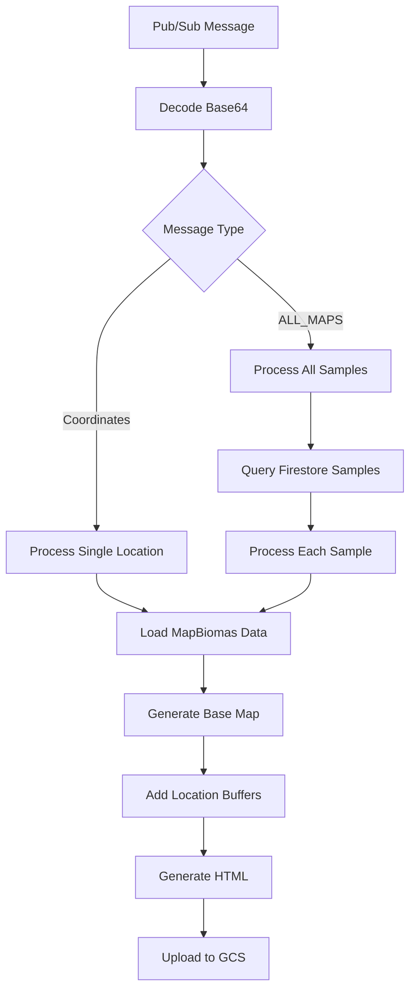

# Fraud Detection Generate Maps

Sistema de geração de mapas interativos para detecção de fraude baseado em dados de uso da terra do MapBiomas.

## Visão Geral

Esta Cloud Function é ativada por mensagens Pub/Sub e gera mapas interativos de uso da terra utilizando o Google Earth Engine e dados do MapBiomas Brazil. Os mapas são criados para análise de detecção de fraude em localizações específicas.

## Arquitetura

```
Pub/Sub Message → Cloud Function → Google Earth Engine → MapBiomas Data → Interactive Map → Google Cloud Storage
```

## Funcionalidades Principais

### 1. Processamento via Pub/Sub

- **Trigger**: Mensagens Pub/Sub codificadas em base64
- **Input**: Coordenadas geográficas (latitude, longitude) ou comando "ALL_MAPS"
- **Processamento**: Decodificação automática de mensagens JSON

### 2. Integração com MapBiomas

- **Dataset**: MapBiomas Brazil Collection 8.0
- **Ano**: Dados de uso da terra de 2021
- **Resolução**: 30 metros
- **Cobertura**: Todo o território brasileiro

### 3. Categorização de Uso da Terra

| Categoria                           | Cor                       | Descrição                     |
| ----------------------------------- | ------------------------- | ----------------------------- |
| 1 - Antrópico                       | `#fffbc2` (Amarelo claro) | Áreas modificadas pelo homem  |
| 2 - Vegetação Primária              | `#09611f` (Verde escuro)  | Vegetação nativa preservada   |
| 3 - Vegetação Secundária            | `#4ea376` (Verde médio)   | Vegetação em regeneração      |
| 4 - Desmatamento em Veg. Primária   | `#e31a1c` (Vermelho)      | Perda de vegetação nativa     |
| 5 - Regeneração de Veg. Secundária  | `#94fc03` (Verde claro)   | Crescimento de vegetação      |
| 6 - Desmatamento em Veg. Secundária | `#ffa500` (Laranja)       | Perda de vegetação secundária |
| 7 - Não aplicado                    | `#212121` (Cinza escuro)  | Sem classificação             |

### 4. Visualização Geoespacial

- **Buffer 1km**: Círculo branco ao redor do ponto de interesse
- **Buffer 10km**: Máscara circular para contexto regional
- **Zoom**: Nível 11 centralizado no buffer de 10km
- **Formato**: Mapa interativo HTML responsivo

### 5. Armazenamento

- **Destino**: Google Cloud Storage
- **Bucket**: Configurável via variável de ambiente
- **Formato**: Arquivos HTML interativos
- **Organização**: Pasta específica por document_id

## Configuração

### Variáveis de Ambiente Necessárias

```bash
# Google Cloud Storage
GCS_BUCKET_NAME=seu-bucket-name
GCS_FOLDER_NAME=mapas-gerados

# Google Earth Engine
# Autenticação via service account padrão do Cloud Functions
```

### Dependências Python

```python
functions-framework>=3.0.0
google-cloud-firestore
google-cloud-storage
earthengine-api
geemap
firebase-admin
```

## Uso

### 1. Processamento Individual

Envie uma mensagem Pub/Sub com coordenadas:

```json
{
  "latitude": -15.7942,
  "longitude": -47.8822,
  "document_id": "sample_12345"
}
```

### 2. Processamento em Lote

Envie uma mensagem para processar todas as amostras:

```json
{
  "command": "ALL_MAPS"
}
```

## Fluxo de Processamento



## Estrutura do Mapa Gerado

### Camadas do Mapa

1. **Base Layer**: Classificação de uso da terra MapBiomas 2021
2. **10km Buffer Mask**: Máscara circular de contexto regional
3. **1km Buffer**: Círculo branco destacando área de interesse

### Especificações HTML

- **Título**: "Land Use details"
- **Dimensões**: 100% largura × 300px altura
- **Responsivo**: Adaptável a diferentes tamanhos de tela
- **Interativo**: Zoom, pan e popup de informações

## Casos de Uso

### 1. Análise de Fraude Individual

- Verificação de uso da terra em localizações específicas
- Análise de mudanças de cobertura vegetal
- Detecção de desmatamento em áreas protegidas

### 2. Análise em Lote

- Atualização de mapas para toda a base de amostras
- Reprocessamento após atualizações do MapBiomas
- Análise comparativa de múltiplas localizações

### 3. Integração com Sistema de Detecção

- Complemento visual para análise isotópica
- Validação de origem geográfica de amostras
- Suporte à tomada de decisão em casos suspeitos

## Monitoramento e Logs

### Métricas Importantes

- Tempo de processamento por mapa
- Taxa de sucesso de upload para GCS
- Uso de recursos do Earth Engine
- Latência de resposta do Pub/Sub

### Logs de Debug

- Coordenadas processadas
- IDs de documentos processados
- Erros de autenticação Earth Engine
- Falhas de upload GCS

## Limitações

### Earth Engine

- Quota de processamento por projeto
- Limite de requisições concorrentes
- Timeout para operações complexas

### MapBiomas

- Dados limitados ao Brasil
- Resolução de 30 metros
- Atualização anual dos dados

### Cloud Storage

- Limite de tamanho por arquivo HTML
- Quotas de bandwidth de upload
- Custos de armazenamento

## Troubleshooting

### Problemas Comuns

1. **Erro de Autenticação Earth Engine**

   - Verificar service account permissions
   - Validar configuração do projeto GEE

2. **Falha de Upload GCS**

   - Confirmar permissões do bucket
   - Verificar quotas de storage

3. **Timeout de Processamento**

   - Reduzir complexidade da área de interesse
   - Implementar retry logic

4. **Coordenadas Inválidas**
   - Validar latitude (-90 a 90)
   - Validar longitude (-180 a 180)
   - Verificar se coordenadas estão no Brasil

## Desenvolvimento

### Estrutura do Código

- `main()`: Entry point da Cloud Function
- `process_sample()`: Processamento de amostra individual
- `process_all_samples()`: Processamento em lote
- `generate_initial_map()`: Criação do mapa base
- `generate_full_map_and_upload_to_gcs()`: Geração e upload final
- `generate_html_file_from_map()`: Conversão para HTML
- `upload_map_to_gcs()`: Upload para Cloud Storage

### Testes Locais

```bash
# Instalar dependências
pip install -r requirements.txt

# Configurar Earth Engine
earthengine authenticate

# Executar função localmente
functions-framework --target=main --source=main.py
```

## Roadmap

### Melhorias Futuras

- [ ] Suporte a múltiplos anos de dados
- [ ] Integração com outros datasets (PRODES, DETER)
- [ ] Geração de mapas em diferentes formatos (PNG, PDF)
- [ ] Cache de resultados para otimização
- [ ] Análise temporal de mudanças
- [ ] API REST para acesso direto
- [ ] Dashboard de monitoramento

### Otimizações

- [ ] Paralelização do processamento em lote
- [ ] Compressão de arquivos HTML
- [ ] CDN para distribuição de mapas
- [ ] Pré-processamento de dados base
